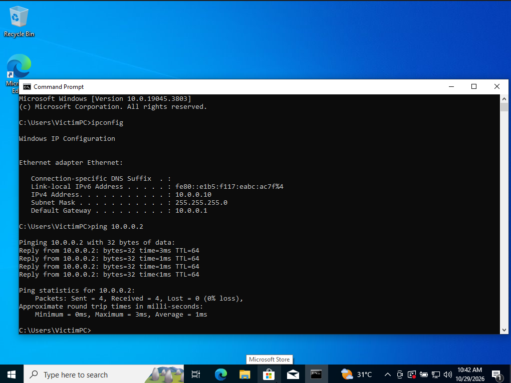
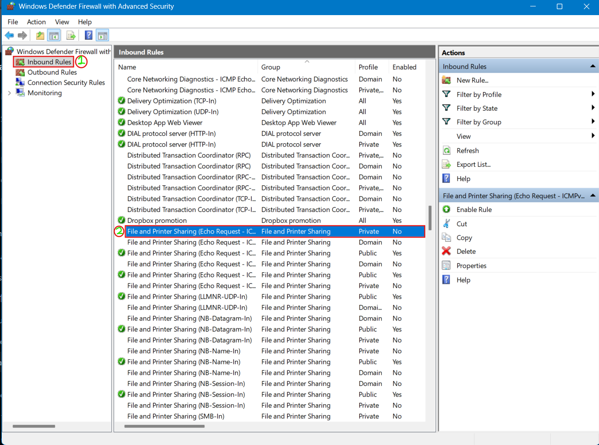
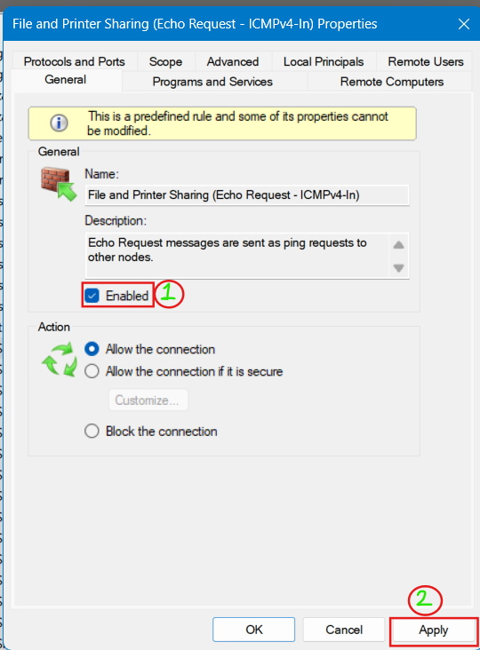
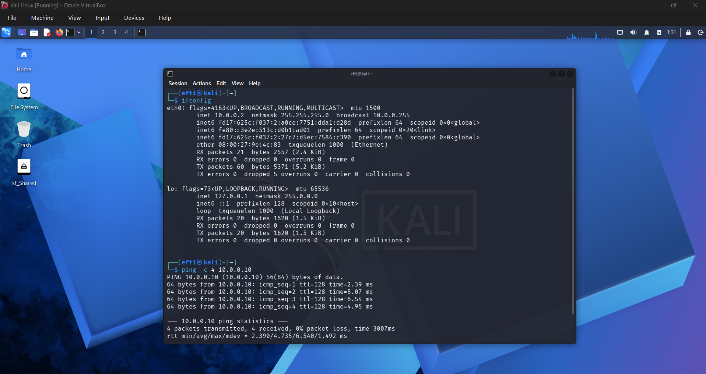

# Windows 10 + Kali Linux Lab on VirtualBox NAT Network

**Week 01 — Extra Project | Network Connectivity and Firewall Troubleshooting**

This project documents setting up Windows 10 Pro and Kali Linux on the same VirtualBox NAT Network, assigning Windows a static IPv4 address, and fixing one-way ping connectivity by enabling the correct Windows Defender Firewall inbound rule.

## Project Overview

Both VMs use the VirtualBox NAT Network `NatNetwork` on `10.0.0.0/24`.

Initially, Windows could ping Kali, but Kali could not receive ping replies from Windows. Kali sent ICMP Echo Requests, but Windows Firewall blocked inbound requests. Enabling **File and Printer Sharing (Echo Request - ICMPv4-In)** for the applicable network profile fixed the issue. After enabling the rule, ping worked from Kali to Windows too.

## Objectives

- Configure Windows 10 Pro and Kali Linux in VirtualBox.
- Connect both VMs to the same NAT Network.
- Set a static IPv4 address on Windows.
- Test connectivity in both directions with `ping`.
- Troubleshoot Windows Defender Firewall blocking inbound ICMPv4 Echo Requests.
- Document the process with screenshots.

## Lab Topology

```text
                 VirtualBox
                    |
       NAT Network: NatNetwork
              10.0.0.0/24
                    |
          +---------+---------+
          |                   |
     Windows 10 Pro        Kali Linux
     10.0.0.10/24          10.0.0.2/24
     Gateway: 10.0.0.1     Gateway: 10.0.0.1
          |                   |
          +---- ICMP ping ----+
               both ways
```

## Network Configuration

| Setting | Windows 10 Pro | Kali Linux |
|---|---|---|
| VirtualBox network | `NatNetwork` | `NatNetwork` |
| IPv4 address | `10.0.0.10` | `10.0.0.2` |
| Subnet mask | `255.255.255.0` | `255.255.255.0` |
| Prefix | `/24` | `/24` |
| Default gateway | `10.0.0.1` | `10.0.0.1` |

**Note:** Avoid conflicts between static IPs and addresses assigned by the NAT Network DHCP server. Adjust the DHCP pool or reserve/exclude these addresses if needed.

## Setup and Troubleshooting

### 1. Configure the VirtualBox NAT Network

1. Open **Oracle VirtualBox Manager**.
2. Go to **Network → NAT Networks**.
3. Create or select `NatNetwork`.
4. Set the IPv4 prefix to `10.0.0.0/24`.
5. Attach both VMs to **NAT Network → `NatNetwork`** in each VM's network settings.

### 2. Set the Windows static IPv4 address

Configure the Windows Ethernet adapter:

- **IP address:** `10.0.0.10`
- **Subnet mask:** `255.255.255.0`
- **Default gateway:** `10.0.0.1`

Verify in Command Prompt:

```bat
ipconfig
```

### 3. Test Windows-to-Kali connectivity

In Windows Command Prompt:

```bat
ping 10.0.0.2
```

The first screenshot shows Windows receiving replies from Kali.

### 4. Test Kali-to-Windows connectivity

In Kali terminal:

```bash
ping -c 4 10.0.0.10
```

Initially, Kali sent packets but received no replies. This pointed to a block on the Windows side, and the Windows Defender Firewall inbound rule was the issue in this lab.

### 5. Enable the Windows Firewall inbound rule

On Windows 10:

1. Open **Start/Search** and search for **Windows Defender Firewall with Advanced Security**.
2. Select **Inbound Rules**.
3. Find **File and Printer Sharing (Echo Request - ICMPv4-In)**.
4. Open its **Properties**.
5. On the **General** tab, tick **Enabled**.
6. Keep **Allow the connection** selected.
7. Confirm the rule applies to the active network profile. The screenshot shows the **Private** profile.
8. Click **Apply**, then **OK**.

This rule allows inbound IPv4 ICMP Echo Requests used by `ping`. Enable only the required rule for the appropriate profile; do not disable Windows Firewall completely.

### 6. Verify Kali-to-Windows connectivity

Run again on Kali:

```bash
ping -c 4 10.0.0.10
```

The final screenshot shows four replies and **0% packet loss**, confirming Kali can ping Windows.

You can also recheck the reverse direction from Windows:

```bat
ping 10.0.0.2
```

## Screenshots

### 1. Windows IP Configuration and Ping to Kali



### 2. Locate the Inbound Firewall Rule



### 3. Enable ICMPv4 Echo Request



### 4. Successful Ping from Kali to Windows



## What I Learned

- VirtualBox **NAT Network** lets multiple VMs share a virtual network.
- Ping working in one direction does not guarantee that the reverse direction works.
- A destination firewall can block inbound ICMP Echo Requests.
- Windows Defender Firewall rules depend on direction and network profile.
- A systematic troubleshooting flow is to verify IP settings, test both directions, and then inspect firewall rules.

## Security Notes

This is a controlled lab for network configuration and firewall troubleshooting. Do not disable the firewall entirely just to make ping work. Enable only the required ICMPv4 Echo Request rule for the right network profile, and make changes only on systems you administer or have permission to configure.

## Author

**Md. Sibgatur Rahman Efti**

- GitHub: [@efti74](https://github.com/efti74)
- LinkedIn: [Md. Sibgatur Rahman Efti](https://www.linkedin.com/in/md-sibgatur-rahman-efti-861b67207/)

---

*Week 01 Extra Project — Windows 10 and Kali Linux Network Connectivity on VirtualBox*
